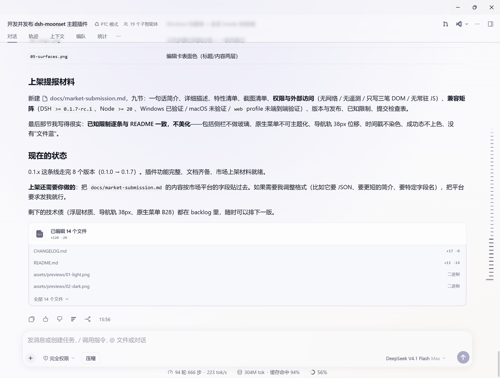
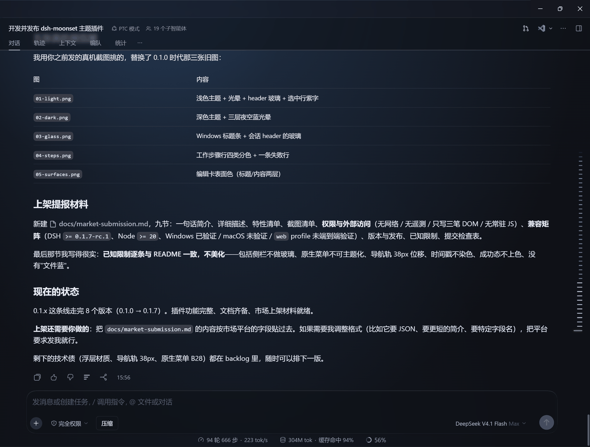
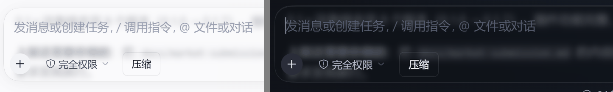
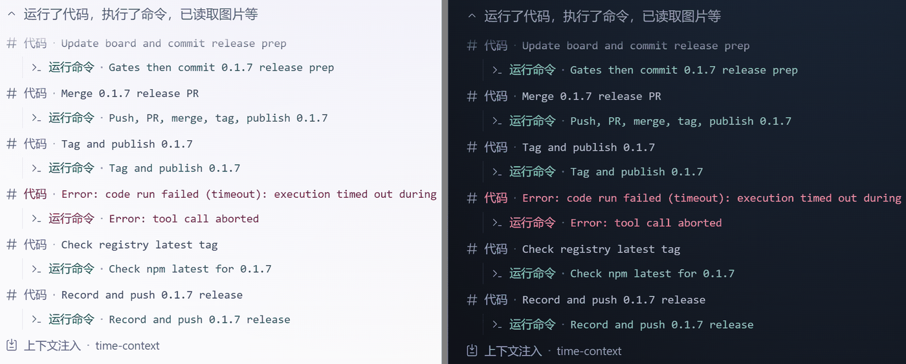
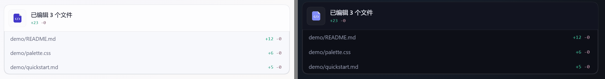
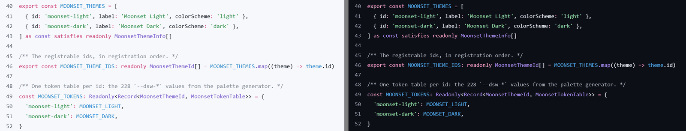
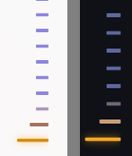
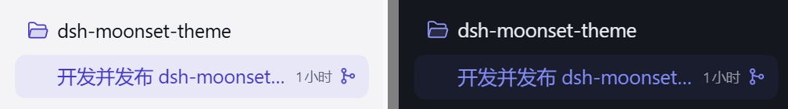

# dsh-moonset-theme

Moonset（月落）是 DeepSeek Harness（下称 DSH）Web GUI 的浅色 / 深色主题插件。
当前版本 **0.1.6**，许可证 MIT。

## 简介

Moonset 向官方主题系统注册 `moonset-light` 与 `moonset-dark` 两个主题定义（各 228 个
`--dsw-*` 颜色 token，取自安装态桌面壳 `0.2.2-rc.5` 的 `design-platform.css`），
并在这张 token 表之外补一层薄皮肤：选中态与文本选区、环境光晕、工作步骤行配色、玻璃材质，
以及编辑卡 / 代码框 / 交付文件卡的表面色。

它补的是官方主题系统留下的两个缺口。一是**第三方主题 id 记不住**：`setTheme(id)` 只把
`light` / `dark` / `system` 写进设置文档，第三方 id 只活在运行时的内存偏好里，
每次 `adopt()` 回声都会被文档值覆盖。二是**首帧闪**：客户端脚本加载之前，页面已经先画了
官方画布。对应做法是插件自带的持久化设置字段，加 Host 半区的一次首帧注入。

整条数据流没有一步联网，也没有常驻 JS（无事件监听、无 `requestAnimationFrame`、
无 observer、无定时轮询；只有一次性的写防抖与样式表重建定时器）。对宿主的 DOM 写只有三笔：
根上摘挂两个布尔属性、`<html>` 上写两个自定义属性（玻璃模糊半径、以及运行时实测的
会话 header 高度）、head 里增删一张自己的样式表。选择存进插件自己的表单，不写官方偏好文档
（`follow` 语义需要的 `system` 除外）。

## 特性

### 主题

- **两个主题定义**：`moonset-light`（`colorScheme: light`）与 `moonset-dark`
  （`dark`），各自一张 228 键的完整 `--dsw-*` 表；`colorScheme` 是单值，
  所以浅深只能是两套定义。
- **跟随系统**：官方偏好保持 `system`，叠一层同时携带浅深两半的覆盖层
  `overrideTokens('dsh-moonset', …)`（228 条，每条一对 `{ light, dark }`）。
- **首帧不闪**：Host 半区在 `webserver/index-inject` 里推两行——head 里一张
  `<style data-dsh-moonset-boot>`（228 条声明 + 画布底色，并列双选择器压过官方的暗色块），
  body 里一条对齐 `data-ds-dark-theme` 的 script；客户端接管后按标识把表删掉。
- **容错注册**：重复 id（`already registered` 一类）被降级成「跳过这一个」，
  重复安装不会拖垮整条 web boot。
- **自带持久化**：选择存进插件自己的 volatile 字段（300 ms 写防抖、后值覆盖前值、
  关闭插件前先 flush），重启自动恢复；官方 Appearance 的显式点击被镜像成「未选择」，
  所以下次启动不会把你的选择盖回来。
- **回声再断言**：`adopt()` 会把第三方主题弹回官方值，插件在 1500 ms 窗口内把它判成
  回声，用 `queueMicrotask` 延后并合并再断言（每波次上限 3 次，到顶打一条 warn 就停手）。

### 皮肤

- **一张表 + 根属性门控**：整层皮肤是一张 `<style data-dsh-moonset-skin>`
  （204 行 / 40 条规则，白名单十类），由 `html[data-moonset-skin]` 门控；卸载零残留。
- **选中态与文本选区**：7 个 token 覆盖（选中 / 激活座位）+ `aria-selected` /
  `aria-current` / `data-active` / `aria-pressed` 等稳定属性钩子，把会话列表、
  设置侧栏、插件页、自动化任务页四处统一成淡紫底 + 紫字；`::selection` 对齐文档站的
  紫底紫字（选中文字对比度浅 5.25:1 / 暗 4.55:1）。
- **环境光晕**：`body` 上一层低对比 wash 加两枚固定光斑（浅色靛蓝月晕 + 右下角琥珀点缀；
  深色是同一支夜空蓝的三层——月核 / 月晕 / 底部反光，加一条更薄的 wash）；浅深各一套色相
  与强度，强度以字面百分比内联进 `background` 表达式。
- **地面范围三档**：按 `[data-slot]` / `[data-composer-seat]` 等稳定属性，用包含关系
  只清「铺满一列或一屏」的承载层底色，卡片、气泡、菜单等内容面一律不碰。
- **工作步骤行按类型分色**：运行命令=绿、读取 / 写入 / 编辑=蓝紫、搜索=琥珀、思考=紫、
  代码与未知工具=强调色兜底、失败=错误色；工具名与参数格子各自取同族混色（65% / 25%），
  失败行只上色不加粗。
- **玻璃材质三面**：输入卡、会话 header、Windows 标题条共用一份配方（画布 62%，顶栏改用
  侧栏色 62%，加背景模糊与 1 px 顶部内高光）；材质画在 `::before` 平面上、
  `z-index: -1` + `isolation: isolate`，容器本体不绘制，所以模糊采样到的是面**之后**的内容。
- **header 悬浮**：header 抬到正文之上（`z-index: 8`），滚动体上移一个 header 高、
  正文起点再用 padding 推回 header 下沿 12 px 处，于是消息从 header 背后滚过去并被糊住；
  header 高度是运行时实测的（有限次重试），实测失败回落宿主最小高度 76 px。
- **回合导航轨染色**：保留宿主自己的 20×2 刻度与 `scaleX` 状态阶梯，只换颜色——当前项
  琥珀 + 4 px 光晕，前后各一项 55%、各两项 28% 过渡，悬停预览（`aria-describedby`）用同一套；
  宿主那 140 ms 过渡是**扩写**（保留 `transform` 与 `background-color`，只加 `box-shadow`）。
- **表面锚点**：编辑卡、代码框、交付文件卡按文档站的确切色值分标题 / 内容两层——
  浅 `#FDFDFE` / `#F7F8FC`，深 `#121420` / `#0D0F17`。皮肤层写死的颜色只有这组
  表面色和夜空蓝锚点（`#2563EB` / `#60A5FA`，只被「夜空蓝」色相读取）；白名单断言把
  整表的 `#` 字面量钉在 6 个。

### 设置

- **一个自己的设置区**：设置里出现「Moonset 主题」（`order: 40`，排在官方设置与同类主题
  插件之后），中文 / 英文两套文案。
- **三段控件**：主题三态按钮；地面范围三档 + 光晕开关 + 浅色 / 深色各一组「色相 + 强度」；
  玻璃开关 + 模糊滑块。
- **一张表单**：所有字段是同一个 Config 里的 volatile 字段，共用一套 300 ms 写防抖；
  地面 / 玻璃的控件变化后 150 ms 原位重建那张单张样式表（不是逐帧，也不加常驻监听）。
- **状态行**：显示「选择 · 官方偏好 X · 当前方案 Y · 覆盖层 已挂载 / 未挂载」，
  把「跟随为什么不跟」的分歧点直接摆在用户面前。

## 预览

截图来自真机（Windows 桌面壳，Moonset 浅色 / 深色）。成对的图都是同一处界面在两种方案下的样子。

| 浅色 | 深色 |
|---|---|
|  |  |

浅色是靛蓝月晕加右下角一点琥珀；深色是同一支夜空蓝的三层地面——月核、月晕、底部反光。

### 玻璃材质



输入卡的半透明与背景模糊（左浅右深）。会话 header 与 Windows 标题条共用同一份配方；
header 悬浮在正文之上，滚动消息从它背后经过并被糊住。

### 工作步骤行配色



运行命令=绿、读取 / 写入 / 编辑=蓝紫、搜索=琥珀、思考=紫、代码与未知工具=强调色；
最后一条是失败行（错误色、不加粗）。工具名与参数各取同族混色，等宽字体只用于这两格。

### 表面色



编辑卡、代码框、交付文件卡共用一套表面锚点，标题层与内容层分两层：
浅 `#FDFDFE` / `#F7F8FC`，深 `#121420` / `#0D0F17`。

### 代码框



代码框的头部与代码体同样走表面锚点；语法高亮沿用既有 token，没有为高亮另造色。

### 回合导航轨



保留宿主刻度的形状与宽度阶梯（未加载更短更淡、悬停略长），只换颜色：
当前项琥珀加光晕，前后各两项按 55% / 28% 过渡，悬停预览用同一套。

### 选中态



选中的会话行是淡紫底加紫字（左浅右深）；文本选区用同一组色。
## 安装

### 从 npm 安装（主路径）

`@aurasuisui/dsh-moonset-theme` 已发布到 npm
（[npm](https://www.npmjs.com/package/@aurasuisui/dsh-moonset-theme) ·
[GitHub](https://github.com/aurasuisui/dsh-moonset-theme) ·
[tag `v0.1.6`](https://github.com/aurasuisui/dsh-moonset-theme/releases/tag/v0.1.6)）。
产物（`lib/`、`cordis.patch.yml`、sourcemap、截图）都在包里，安装时不需要构建：

```powershell
# 桌面壳的 profile 只能由它自带的这个 CLI 管：npm 全局装的 dsh 会直接拒绝
# （error: profile "desktop" is managed exclusively by the Electron application）。
$dsh = Join-Path $env:LOCALAPPDATA 'Programs\DeepSeek Harness\resources\runtime\cli\bin\dsh.cmd'
& $dsh plugin --profile desktop add @aurasuisui/dsh-moonset-theme
```

**先完全退出桌面壳再执行**：这条命令的实质是在 profile 目录里跑 pnpm（
`dsh plugin --help` 原文：把剩余参数转发给 profile 里的 pnpm），它会重写该 profile 的
`package.json` 并安装依赖；装完重开桌面壳，设置里就会出现「Moonset 主题」。
web profile 用同一条命令，把 `--profile desktop` 换掉即可。

卸载：`& $dsh plugin --profile desktop remove @aurasuisui/dsh-moonset-theme`。
只想临时关掉而不卸载：在 profile 的插件配置里把该条目设成 `disabled: true`，重启后插件
不激活，仓库和链接都还在。对**宿主** DSH 本身的版本要求写在 `package.json` 的
`engines.dsh` 里（DSH 的版本号与插件版本号是两套，别混读）。

### 从本地仓库安装（开发用）

`link:` 指向的是工作副本，仓库不提交 `lib/`；而 `npm publish` 与
`dsh plugin add git+https://…` 会走 `prepare` 钩子自动构建，本地 link 不走。

```powershell
# 0) 在仓库根构建产物（lib/index.js 与 lib/client.js）
pnpm install
pnpm build

# 1) 把仓库挂进目标 profile 的 plugins/ 目录（Windows 用 junction）
$repo    = 'C:\Users\<you>\Desktop\Anything\dsh-moonset-theme'
$profile = Join-Path $env:USERPROFILE '.dsh\profiles\desktop'
New-Item -ItemType Directory -Force (Join-Path $profile 'plugins') | Out-Null
New-Item -ItemType Junction -Path (Join-Path $profile 'plugins\dsh-moonset-theme') -Target $repo

# 2) 备份 profile 的 package.json（文件名带时间戳，便于回滚）
Copy-Item (Join-Path $profile 'package.json') (Join-Path $profile ('package.json.bak-moonset-' + (Get-Date -Format 'yyyyMMddHHmmss')))

# 3) profile 里要有这三处：
#      package.json  dependencies          "@aurasuisui/dsh-moonset-theme": "link:plugins/dsh-moonset-theme"
#      package.json  dsh.profile.bundles   末尾加 "@aurasuisui/dsh-moonset-theme"
#      cordis.patch.yml  - id: dsh-moonset / name: '@aurasuisui/dsh-moonset-theme'
#                        （这条 insert 行由本仓库的 bundle patch 提供）

# 4) 让 profile 解析这条 link，然后重启桌面壳
Push-Location $profile; pnpm install; Pop-Location
```

**回滚**（三步，做完重启）：

1. 用备份覆盖回 `package.json`（`Copy-Item package.json.bak-moonset-<时间戳> package.json`，
   或手动删掉那条依赖与 bundles 条目）；
2. 删除 junction：`Remove-Item (Join-Path $profile 'plugins\dsh-moonset-theme')`
   （目标仓库本身不动）；
3. 在 profile 里 `pnpm install`，重启桌面壳。设置里不再出现「Moonset 主题」即回滚成功。

## 使用

### 主题三态

1. 打开 **设置**，找到「Moonset 主题」。
2. 点 **浅色** / **深色** → 立刻切换，并把选择存进插件自己的设置；重启后自动恢复。
3. 点 **跟随系统** → 官方偏好被设为「跟随系统」，Moonset 的浅深两半由系统决定；
   此时官方 Appearance 里显示「跟随系统」，不是 `moonset-*`。
4. **回到官方主题**：去官方 Appearance 选 light / dark / system。插件看到这次显式选择后
   会把自己的记录镜像成「未选择」，所以下次启动不会把你选的主题盖回来。
5. **升级**：npm 装的用同一条 `add` 命令重装；`link:` 装的在仓库根重新 `pnpm build` 再重启桌面壳即可。

几个不带意外的行为：

- 「未选择」是默认值，插件不会在启动时替你写官方偏好；只有你选过浅色 / 深色 / 跟随系统
  才会恢复。
- 选「跟随系统」会把官方 Appearance 的偏好设成「跟随系统」——这是让跟随层生效的前提，
  属于你选择的语义，不是插件自作主张。

### 地面范围

「Moonset 主题」下方是地面控件。三档是**嵌套**的，各自清掉的承载层不同：

| 档 | 按钮 | 额外清掉的承载层 | 侧栏 | 底部 |
|---|---|---|---|---|
| A | 会话区 | 只透会话列 | 保留自己的面 | 保留 |
| **B** | **主区（默认）** | 外壳与三列 | 保留侧栏色内层 | 保留 |
| C | 全透 | B + 侧栏内层 + 底部单元 | 透出地面 | 透出地面 |

只清「铺满一列或一屏」的承载层；卡片、消息气泡、代码块、输入卡、菜单弹层一律不碰。

### 光晕的色相与强度

| 控件 | 取值 | 默认 |
|---|---|---|
| **环境光晕** | 开 / 关 | **开** |
| **浅色光晕** | 色相：强调 / 柔和 / 夜空蓝；强度 0–200%（步长 10） | **柔和 90%** |
| **深色光晕** | 同上 | **夜空蓝 100%** |

- 两套完全独立：动浅色那组，深色的规则文本一个字都不变，反之亦然。
- 色相乘数只作用于色相层；琥珀只出现在浅色，且只随浅色强度缩放。
- 强度 0 等于只剩底色。关掉「环境光晕」会整段移除（含夜空蓝锚点与地面可见性规则），
  回到纯色地面，而不是把 alpha 归零。

### 玻璃开关与模糊

| 控件 | 取值 | 默认 |
|---|---|---|
| **玻璃材质** | 开 / 关 | **开** |
| **模糊** | 0–30 px（步长 2） | **12 px** |

- 三面共用同一份配方：**输入卡**、**会话 header**、**Windows 标题条**。
- 模糊 0 只剩半透明底——老旧显卡或 compositing 不可用时就是这个保底。
- 关掉开关：三面一起回到宿主原样，滚动体也回到宿主布局。
- 模糊半径写在 `<html>` 的一个行内自定义属性上，所以拖动滑块是「改一个值」，
  不是「重解析一张表」。

### 轨迹配色是什么意思

消息流里的工作步骤行按**类型**上色，颜色只落在标签格上，正文与代码块不受影响：

| 类 | 行样式 | 色相 |
|---|---|---|
| 运行命令 | `运行命令 · …` | 绿 |
| 读取 / 写入 / 编辑 | `读取 · path` | 蓝紫 |
| 搜索 | `搜索文件内容 · …` | 琥珀 |
| 思考 | `思考 · …` | 紫 |
| 代码 / 其它 / 未知工具 | `代码 · …` | 强调色（兜底） |
| 失败 | 同上，末尾带退出码胶囊 | 错误色，只上色不加粗 |

工具名与参数 / 路径两个格子各自取同族混色（65% / 25%），等宽字体只用于这两格。
成功（退出码 0）不额外上色，原因见下一节。

## 已知边界

以下每条都能在仓库文档里找到出处；没有真机证据的一律按原文标注。

- **侧栏不做玻璃材质。** 侧栏保持宿主的侧栏色内层，材质段完全不碰它；这是有意的取舍，
  不是漏做。
- **标题条「应用 / 编辑」的下拉菜单不可主题化。** 按钮本身是 HTML（已随调色板），
  但下拉是 Electron / OS 原生菜单（`Menu.buildFromTemplate().popup()`），不吃 CSS；
  且它的明暗只跟 `nativeTheme.themeSource`，不随第三方主题的 `data-ds-theme-source` 变化。
  真主题化要宿主把菜单改成 HTML。记为 backlog B28。
- **回合导航轨有 38 px 位移。** header 悬浮让滚动体 `clientHeight` 增加一个 header 高，
  宿主按它定位的导航轨因此上移约 H/2（76 / 2 = 38 px）；**只在切换玻璃开关时**能直接看到
  这个跳动，常开状态无跳动。导航轨只有哈希类名、没有稳定钩子，彻底修需要宿主给稳定属性。
- **选中会话行的时间戳不染色。** 它是裸 `<span>`，没有 `<time>`、没有 `data-*`，
  类名按构建哈希；按「不用 `[class*=]`」的规矩不做脆弱选择器，行标题仍是紫的。
- **成功态（退出码 0）不上色。** 退出码胶囊永远是中性色、且只在失败时渲染；把整行
  `data-state='ok'` 染绿会波及全部轨迹行，所以只做失败侧。
- **没有真正的「文件蓝」。** 228 键表里没有 `sky` / `cyan` 家族，`blue-*` 整体被
  重映射成靛蓝，所以文件类只能用与强调色同族、差一档亮度的 `deepseek-400`。
  真正拉得开色相的只有绿 / 琥珀 / 紫三支。
- **与其它主题插件互斥掌权。** 可以同装（注册表、层、卸载互不影响），但对方会回弹第三方
  主题 id，同一时刻只让一方掌权；切到另一方前先把这一方关掉。事实与源码位置见
  [docs/compatibility.md](docs/compatibility.md)。
- 其余真实存在的限制：**:root{color-scheme} 没发**（官方偏好与所选主题明暗相反时，UA 控件 /
  滚动条可能短暂按官方方案画，见 backlog B11）；**macOS 未验证**（样式表里有 9 个名字只
  出现在 `html[data-platform='darwin'] body` 层，特异性高过我们的选择器，本机是 Windows）；
  **多窗口不同步**（一个窗口改了设置，另一个窗口的按钮要等下次读取才采纳）；
  **1500 ms 窗口**（写完设置后 1.5 秒内去官方 Appearance 点 light/dark/system，会被当成回声
  再断言，那次点击不镜像成「未选择」，下一次任意设置写入后自愈）；**官方 Appearance 里显示
  裸 id**（官方注册表不存第三方主题的 label，那里会显示 `moonset-light` / `moonset-dark`，
  插件自己的设置区显示的是正常文案）；**窗控按钮的 hover / 按下**由 Windows 自绘，仍是系统色；
  **未加载的导航刻度**没有独立色（宿主没给属性，保留宿主自己更短更淡的形态，颜色随 accent
  走）；**「上下文注入」的 `toolBlocks` 变体**仍停在行默认色（折叠内容上两个稳定属性都
  没有）；**没做像素级 A/B**（与其它主题插件同时生效时「谁的 `--dsw-*` 赢」由内联样式
  顺序决定）。

装坏了怎么回：见上文「回滚三步」——只需要 `Remove-Item` 一个 junction 并还原
`package.json` 备份，仓库本身不会被改动。

## 开发

### 命令

```powershell
pnpm install                 # 依赖
pnpm build                   # 产物：lib/index.js（Host）与 lib/client.js（客户端）
pnpm test                    # 258 条 / 9 个文件
pnpm typecheck               # 源码类型检查
pnpm typecheck:tests         # 测试侧类型检查
```

审计脚本（都可离线跑）：

```powershell
node scripts/extract-dsw-tokens.mjs     # 只读打开安装态 app.asar → themes/dsw-tokens.json
git checkout -- themes/dsw-tokens.json  # 该脚本非幂等（meta.extractedAt 每次都变），跑完还原
node scripts/verify-tokens.mjs          # 期望 missing=0 retired=1 live=228
node scripts/generate-palettes.mjs      # 重生成 src/client/palettes.ts（应无 diff）
```

### 目录结构

```text
src/
  index.ts                 Host 半区：Config 声明 + webserver/index-inject
  boot-palette.ts          首帧那两行（style + script）与源码注释
  client/
    index.ts               客户端装配：注册、订阅、再断言、设置区挂载
    themes.ts              theme.register ×2 + 跟随层（overrideTokens）
    choice.ts              选择 → 官方偏好的映射、状态行拼装
    durable.ts             volatile 表单的读写（300 ms 防抖 + 回声水位）
    registration-tolerance.ts  重复 id / 重复槽位降级为跳过
    boot-cleanup.ts        撤首帧表
    skin.ts                皮肤层：单张样式表（十类白名单）+ 常数
    palettes.ts            228 键 × 浅深两套（自动生成，勿手改）
    settings-section.tsx   设置区组件
    locales.ts             中文 / 英文两套文案
scripts/                   取证、校验、生成、共存检查
themes/                    228 键表 + 16 个源色锚点 + 冻结名单 + 退役名单
tests/                     258 条 / 9 个文件
docs/                      架构、调色板、兼容性、backlog、各版计划
assets/previews/           真机截图（浅/深/玻璃/步骤行/表面色 五张）
```

### 文档索引

| 文档 | 一句话 |
|---|---|
| [docs/README.md](docs/README.md) | 文档总入口 |
| [docs/architecture.md](docs/architecture.md) | 两半区职责、228 个 token 从哪来、注册与跟随层、自带持久化、首帧注入、adopt 回声与再断言、CSS 注入白名单十类 |
| [docs/palette.md](docs/palette.md) | 16 个源色锚点（浅 / 深）、A / B1 / B2 / B3 分类规则、对比度契约的实测值 |
| [docs/compatibility.md](docs/compatibility.md) | 与其它主题插件共存的事实记录（互斥掌权） |
| [docs/backlog-v0.2.md](docs/backlog-v0.2.md) | 已知债条目（B1–B28） |
| [docs/plans/v0.1.6.md](docs/plans/v0.1.6.md) | 0.1.6 契约：表面锚点 |
| [docs/plans/v0.1.7.md](docs/plans/v0.1.7.md) | 0.1.7 契约：README 重写与上架准备 |
| [docs/market-submission.md](docs/market-submission.md) | 上架插件市场的提报材料（简介 / 特性 / 截图 / 权限 / 兼容矩阵 / 版本） |
| [CHANGELOG.md](CHANGELOG.md) | 每个版本交付了什么 |

改代码之前请先读 [docs/architecture.md](docs/architecture.md)；改配色看
[docs/palette.md](docs/palette.md)；皮肤层新增任何一条 CSS 都要过
[docs/architecture.md](docs/architecture.md) §11 的白名单门槛。

## 致谢 / 许可

### 配色来源

这套配色的**原始出处**是 MoonBit 社区作者 [Wyatex](https://github.com/Wyatex) 的文档站
[unmbt/moonset-document](https://github.com/unmbt/moonset-document)。作者在 MoonBit 交流群里分享了那个站点，
我问「配色很好看，能拿来做 DSH 主题插件吗」，作者很爽快地说「拿去抄」——这个插件就是这么来的。
16 个源色锚点、A / B1 / B2 / B3 的分类规则都照那个站点的取色与对比度口径来做，详见
[docs/palette.md](docs/palette.md)。**配色归功于原作者，插件只负责把它搬到 DSH 上。**

### 其它


- 228 个 `--dsw-*` token 与「两半区 + bundle patch」的插件形态来自 DeepSeek Harness
  官方的主题层与插件加载器；本仓库只提供配色、皮肤表与装配代码。
- 玻璃材质画在 `::before`、header 悬浮的滚动体位移、以及若干「稳定属性优先」的写法，
  是在真实宿主上反复试错后才定下来的；取舍与反例都记在
  [docs/architecture.md](docs/architecture.md) §11。

许可证 **MIT**，全文见 [LICENSE](LICENSE)。
